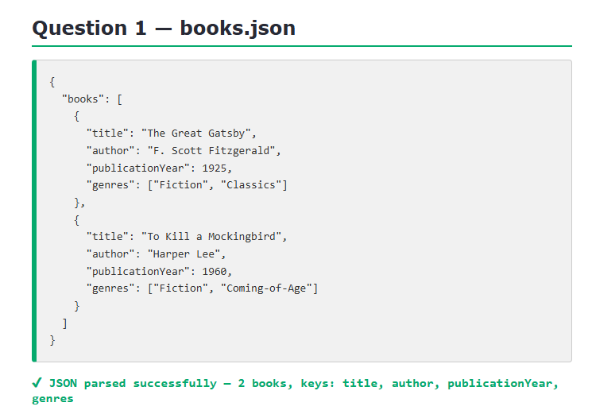
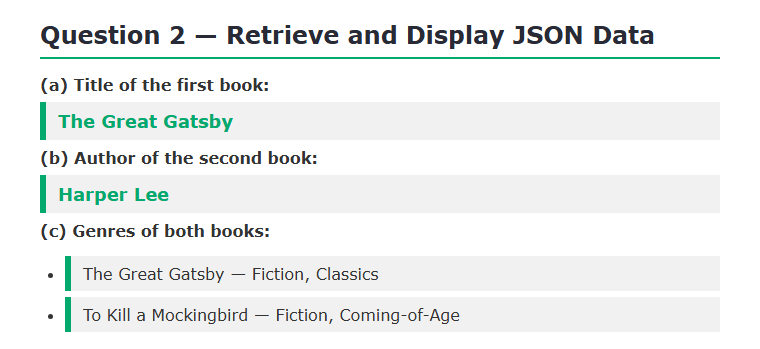
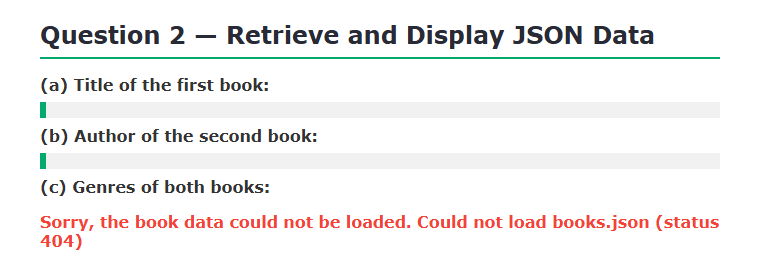
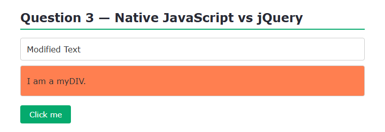
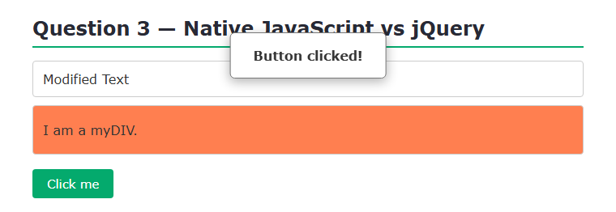

# BIC21203 — Lab 4b: JSON and jQuery

**Name:** TAN YUE HENG
**Matric No:** AI240167
**Course:** BIC21203 Web Development
**Lab:** 4b — Client-Side Scripting (JSON and jQuery)

---

## About this lab

This lab covers reading JSON data with `fetch()` and rewriting three native
JavaScript operations using jQuery. No frameworks or build tools are used.

## Files

```
Lab4b/
├── books.json          Question 1 — the book data
├── books.html          Question 2 — page that displays the data
├── books.js            Question 2 — fetch() + display logic
├── jquery-dom.html     Question 3 — native vs jQuery
├── jquery-dom.js       Question 3 — the jQuery code
├── style.css           shared stylesheet
└── screenshots/        output screenshots
```

## How to run

Question 2 uses `fetch()`, which browsers block on `file://` URLs, so a local
server is **required**.

**Option 1 — VS Code Live Server**
1. Open the `Lab4b` folder in VS Code.
2. Right-click `books.html` → **Open with Live Server**.

**Option 2 — Python**
```bash
cd Lab4b
python -m http.server 8000
```
Then open <http://localhost:8000/books.html>.

Question 3 (`jquery-dom.html`) and the JSON file can also be opened directly,
but using the same local server for all pages is simplest.

---

## Question 1 — Create and Structure JSON Data

`books.json` has a top-level `books` array holding two book objects. Each object
has `title` (string), `author` (string), `publicationYear` (number) and `genres`
(array of strings). Property names are double-quoted and there are no trailing
commas.



The file parses successfully as JSON and contains 2 books.

---

## Question 2 — Retrieve and Display JSON Data

`books.js` loads `books.json` with `fetch()` and writes the results into the page
using `textContent` and `createElement()` — never `innerHTML`.

- **(a)** Title of the first book → *The Great Gatsby*
- **(b)** Author of the second book → *Harper Lee*
- **(c)** Genres grouped by title → *The Great Gatsby — Fiction, Classics* and
  *To Kill a Mockingbird — Fiction, Coming-of-Age*



**Error handling:** if the request fails (`response.ok` is false) or the JSON is
invalid, a friendly message is shown instead of a blank page:



---

## Question 3 — Compare Native JavaScript and jQuery

`jquery-dom.html` loads jQuery 4.0.0 from the official CDN (full build):

```html
<script src="https://code.jquery.com/jquery-4.0.0.min.js"></script>
```

The three native operations were rewritten with jQuery:

| Native JavaScript | jQuery used |
|---|---|
| `document.getElementById("myElement").textContent = "Modified Text";` | `$("#myElement").text("Modified Text")` |
| `document.querySelector("#myDIV").classList.add("myStyle");` | `$("#myDIV").addClass("myStyle")` |
| `document.getElementById("myButton").addEventListener("click", () => alert(...));` | `$("#myButton").on("click", ...)` |



Clicking the button shows the alert:



**One advantage of native JavaScript:** it needs no external library, so there is
nothing extra to download and the page loads faster with no dependency to keep
updated.

**A situation where an existing project may still use jQuery:** projects built
before modern browsers supported `fetch()`, `querySelector()` and `classList` were
often written with jQuery, and jQuery's cross-browser compatibility still helps
when maintaining legacy code or supporting older browsers.
